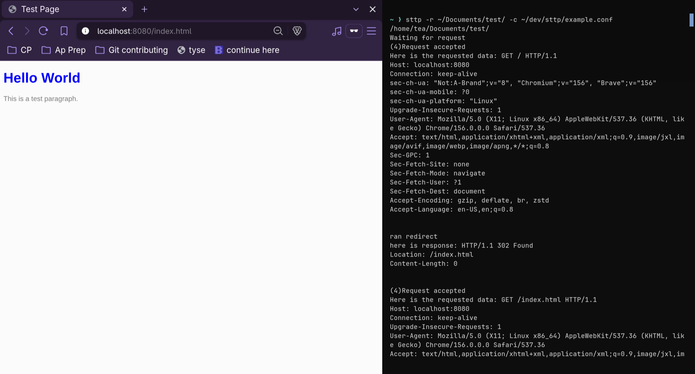

# Supertext-transfer-protocol-sttp
> As the name may not suggest, this is not http or anything. But a simple web server (or http server, idk what to call it) written in c. 


## what is sttp?
sttp is a web and http server that allows you to host a website with a root directory and a config file. 

Written in c, sttp uses the many abstracted system calls provided by the <sys/...> libraries in c to listen and wait for an http request, and responding with an http response. Currently based around http/1.1 with limited functionality. 

In addition to http requests and response, the config file passed in as an argument can be used to map a path and a http method to an action (currently only supporting ```redirect```) with an additional ```args``` arugment for the action. 

<p align="center">

</p>


## features 
+ Configuration file (mappings)
  + Currently only redirect is supported
+ Static file viewer
+ Http error codes (some of them)
+ GET and HEAD response on fallback from mappings
+ Command Line Interface


## build
```bash
git clone https://github.com/Tawhidulh1/sttp.git
cd sttp
make
# or install/uninstall to bin
make install  # Set custom path with PREFIX=... following make install/make uninstall
```
## usage
```bash
sttp -r <path-to-site-root> -c <path-to-config>
# both root and config are required
# config can be left empty and you can point to any readable file (.txt, .yaml, .config) see example.conf to example
```


## known issue
When using the binary and going to localhost:8080 some browsers may default to ```https://localhost:8080```, simply fix this by removing the s in https


## License
MIT
